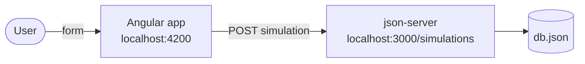

# Loan Calculator: High-Level Design

An Angular app that calculates the interest and total payable on a home, car or personal loan, shows a principal-vs-interest bar chart and saves each simulation to a mock REST API. For code-level detail see the [Low-Level Design](lld.md).

## 1. Context



## 2. Pages

| Route | Page |
|---|---|
| `/home` (default) | Landing page |
| `/loan-calculator` | Form, results and bar chart |
| `/about` | About the app |

## 3. Tech

| Item | Choice |
|---|---|
| Framework | Angular (modules, reactive forms, HttpClient, RxJS) |
| Mock API | json-server watching `db.json` |
| Tests | Karma + Jasmine |

## 4. Run

```bash
npm install
npm run start-json-server   # API on :3000
npm start                   # app on :4200
```
