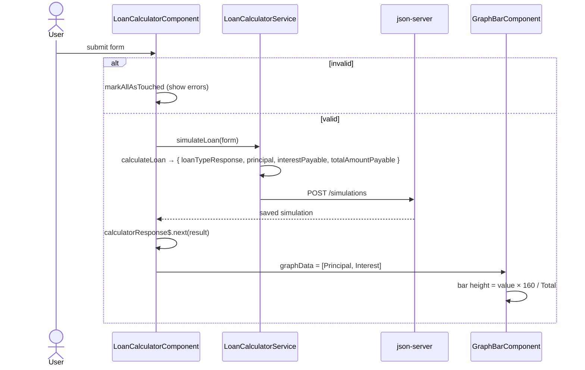

# Loan Calculator: Low-Level Design

For the big picture see the [High-Level Design](hld.md).

## 1. Form (`LoanCalculatorComponent`)

| Field | Default | Validation |
|---|---|---|
| `loanType` | none | Required: Home (1), Car (2), Personal (3) |
| `loanAmount` | 1 000 | 1 000 – 200 000 |
| `interestAmount` (annual %) | 10 | 0.1 – 25 |
| `loanTerm` | 1 | 1 – 60 |
| `termType` | `year` | `year` or month |

## 2. Calculation (`LoanCalculatorService.calculateLoan`)

```
periods          = loanTerm × (12 if termType = year else 1)
interestPayable  = round( P × (1 + r / 12)^periods − P )     where r = annual rate / 100
totalPayable     = P + interestPayable
```

For terms in years this is interest compounded monthly. (With `termType` = month the divisor is 1, so the monthly case applies the full annual rate per month.)

## 3. Submit flow



## 4. Components

| Component | Role |
|---|---|
| `NavbarComponent` | Links: Home, Simulation, About |
| `SliderComponent` | Range input bound to a form control (`min`, `max`, `step`) |
| `GraphBarComponent` | Bars sized relative to the sum of values |
| `FooterComponent`, `HomeComponent`, `AboutComponent` | Static views |

## 5. Known issues

| Issue | Fix |
|---|---|
| `GraphBarComponent.Total` is never reset, so bars shrink after each new calculation | Set `this.Total = 0` at the start of `MontarGrafico()` |
| Month terms divide the annual rate by 1 | Use `r / 12` for both term types and only change the period count |
